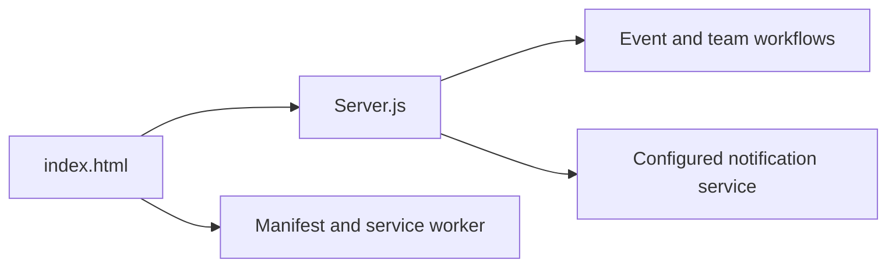

# TechHunt 2026 Treasure Hunt

## Overview

TechHunt 2026 is a browser/PWA event application prototype. The repository contains event pages, a Node.js server, team-management helpers, notification assets, and screenshots documenting the intended event experience.

## Architecture



## Project structure

- `Server.js` — server entry point.
- `index.html` — event interface.
- `add-teams-51-55.js` — team-data utility.
- `Manifest.json`, `sw.js` — PWA support.
- `Railway.json` — deployment configuration.
- `screenshots/` — genuine project screenshots.

## Run locally

```bash
npm install
npm start
```

Keep notification keys, VAPID values, and event administration credentials in environment variables.

## Security considerations

Event registration and team data require authenticated administration, validation, rate limiting, and protected secrets before production use.

## Status

Event application prototype.

## License

No license is currently declared.
