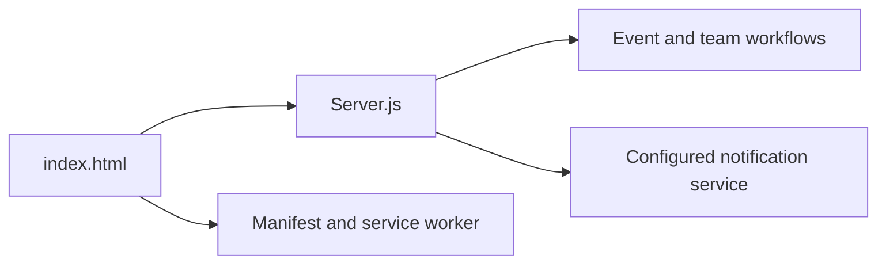

# TechHunt 2026 Treasure Hunt

## Overview

TechHunt 2026 is a browser/PWA event application prototype. The repository contains event pages, a Node.js server, team-management helpers, notification assets, and screenshots documenting the intended event experience.

## Architecture



## Project structure

- `Server.js` — server entry point.
- `index.html` — event interface.
- `add-teams-51-55.js` — team-data utility.
- `Manifest.json`, `sw.js` — PWA support.
- `Railway.json` — deployment configuration.
- `screenshots/` — genuine project screenshots.

## Run locally

```bash
npm install
npm start
```

Keep notification keys, VAPID values, and event administration credentials in environment variables.

## Security considerations

Event registration and team data require authenticated administration, validation, rate limiting, and protected secrets before production use.

## Status

Event application prototype.

## License

No license is currently declared.

## Genuine project assets

The repository includes screenshots of the event flow:

- [Install screen](screenshots/techhunt-install-ready.jpg)
- [Login screen](screenshots/techhunt-login.jpg)
- [Event gate](screenshots/techhunt-event-gate-ready.jpg)

These files are repository assets, not a hosted production demo.

## Configuration

Copy `.env.example` to `.env` for local setup. Keep database, storage, mapping, notification, and authentication values out of Git.

## API and project docs

- [API reference](docs/API.md)
- [Contributing](CONTRIBUTING.md)
- [Security policy](SECURITY.md)
- [Changelog](CHANGELOG.md)

## Accessibility and mobile notes

The repository contains browser-facing pages intended to be tested at narrow and wide viewport sizes. Before deployment, verify keyboard navigation, visible focus states, form labels, meaningful image alternatives, readable contrast, touch-sized controls, and layouts without horizontal scrolling.

## Validation

No automated test suite is declared unless noted in `package.json`. At minimum, install dependencies, run the documented start/build/type-check commands, and manually exercise the primary page and API health route where available.
